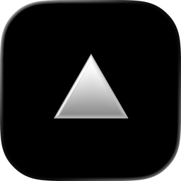
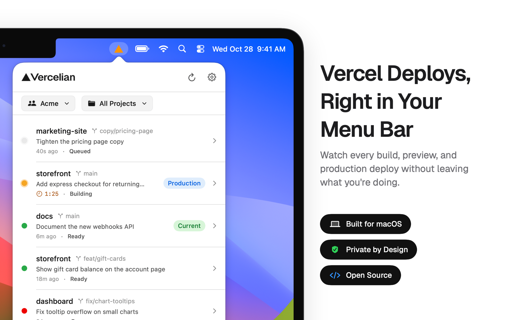

<div align="center">



# Vercelian

**Your Vercel deployments, live in the macOS menu bar.**

[](#install)
[](#build-from-source)
[](LICENSE)

[Download](https://vercelian.co/Vercelian.zip) · [Privacy](PRIVACY.md) · [Report an issue](https://github.com/deebov/vercelian/issues)

<sub>An unofficial app, not affiliated with or endorsed by Vercel Inc.</sub>

</div>

<br>



## Features

- **Live status.** Every build, preview, and production deploy across your projects, refreshed every 10 seconds.
- **An icon that keeps you posted.** The menu bar triangle turns orange while your latest deploy builds and red if it fails.
- **Failure alerts.** Get a notification as soon as a deploy fails, and optionally when one succeeds.
- **Teams and projects.** Switch between your personal account and your teams, and filter by project.
- **Every detail.** See the branch, commit, repository, and environment of any deployment, and copy its URL.
- **Actions.** Cancel a build, redeploy, open the site, or inspect it on Vercel.
- **Swipe for shortcuts.** Swipe left on a deployment with two fingers to visit it, open it on Vercel, or jump to its logs.
- **Native and private.** Built with SwiftUI, follows light and dark mode, keeps your token in the Keychain, and has no analytics.

## Install

**Mac App Store:** coming soon.

**Direct download:** download [`Vercelian.zip`](https://vercelian.co/Vercelian.zip), unzip it, and move Vercelian to your Applications folder. It's signed with a Developer ID and notarized by Apple, so macOS opens it like any other app from the internet.

## Get started

1. Click the triangle in your menu bar.
2. Click **Continue with Vercel**. Your browser opens [vercel.com/account/tokens](https://vercel.com/account/tokens).
3. Create a token, copy it, paste it into Vercelian, and click **Connect**.

If the token expires or is revoked, Vercelian signs out and asks for a new one.

<details>
<summary>Can't find the menu bar icon?</summary>

<br>

On a MacBook with a notch, macOS hides status icons that don't fit to the right of the notch, starting with the most recently opened app. To bring Vercelian back, quit another menu bar app or two, then hold <kbd>⌘</kbd> and drag the triangle further right. macOS remembers the new position.

</details>

## Privacy

Vercelian has no servers, analytics, or tracking. Your access token is stored in the macOS Keychain and sent only to Vercel's API over HTTPS, and your deployment data is kept in memory, never on disk. The [privacy policy](PRIVACY.md) has the details.

## Build from source

You need macOS 14 or later and Xcode 16 or later.

```bash
git clone https://github.com/deebov/vercelian.git
open vercelian/Vercelian.xcodeproj
```

Choose your own team under **Signing & Capabilities**, then press <kbd>⌘</kbd><kbd>R</kbd>.

Every push and pull request is built by [GitHub Actions](.github/workflows), and version tags are released automatically.

## Contributing

Issues and pull requests are welcome. For anything bigger than a small fix, please open an issue first so we can talk it through.

## License

Vercelian is available under the [MIT license](LICENSE). Inspired by [Deplog](https://apps.apple.com/app/deplog/id6739449266).

## Disclaimer

Vercelian is an independent project, not an official Vercel app. It isn't affiliated with, endorsed by, or sponsored by Vercel Inc. Vercel is a trademark of Vercel Inc.

For help with Vercelian, please [open an issue](https://github.com/deebov/vercelian/issues) here instead of contacting Vercel.
